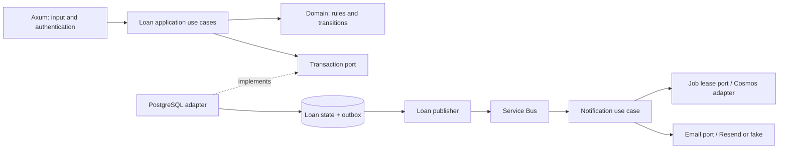

# ADR 0004: Backend use cases, transactions and recovery

Date: 2026-11-01. Status: **selected direction; Loan phase 1 implemented and verified locally, remaining phases planned**. See [phase 1 handoff](../../backend/phase-1-handoff.md). Not deployed by phase 1. User requested an updated backend design and four isolated implementation sessions after the CIS3039 review. Specific mechanics below are design choices to validate in implementation, not claims of tutor approval.

## Reason

The existing stack fits the assessment. The main gaps are business decisions inside SQL adapters, due dates assigned at collection rather than reservation, concurrent notification claims, incomplete authenticated user flows and unproved delivery gates. Correct these within the current service boundaries.

## Design

Keep Next.js, Auth0, Rust/Tokio/Axum, PostgreSQL, Service Bus, independent Notifications/Cosmos/Resend and Container Apps. Keep two business services. The publisher belongs to Loan, even when deployed as a separate process. Do not add a generic service or repository framework.

### Loan rules and transaction ownership

- Use explicit reserve, subscribe, collect and return application use cases. HTTP validates shape and identity; use cases enforce authorization and call domain rules. Database adapters implement storage, locks and constraints.
- Use a transaction-scoped port: begin, load locked state, apply a domain decision, save state plus required outbox requests, commit. Application code owns the operation; infrastructure owns the database transaction. Keep vendor types out of domain/application APIs.
- All availability and transition decisions use the state locked in that same transaction. Never move a check outside the transaction merely to make layers look clean. Use consistent lock order across reserve/collect/return; retain constraints and bounded connection use. No remote calls while holding SQL locks.
- Domain functions return state changes and notification intents; Loan decides recipients. Capture clock/ID inputs through small ports where needed for repeatable tests. Implement only ports used by real use cases.
- At reservation, assign and return `due_at = reserved_at + 2 days` in UTC. Collection records its timestamp and preserves that date. This is the plan's explicit reading of the brief; any tutor-approved different rule must update this ADR and tests before implementation. Do not silently extend a loan on collection.
- Use explicit `RESERVED → COLLECTED → RETURNED` transitions. Returning an uncollected reservation must not masquerade as a physical return; cancellation/expiry is outside this plan unless agreed scope requires it. Reject repeated/invalid transitions without duplicate business events.
- Support all active eligible waitlist recipients on return. Define duplicate-subscription behaviour and test it. Retain stable single-recipient event IDs and atomic outbox writes.
- Use additive migrations. Preserve existing non-null due dates; backfill missing dates using known reservation timestamps under a documented rule. Inspect existing data before changing constraints; never reset deployed data for this refactor.

### Notification ownership and recovery

- Keep the existing versioned message envelope unless a real change is needed. Document fields, validation, correlation, event identity and version compatibility; no PostgreSQL access or Loan lookup from Notifications.
- Add explicit job lease ownership: owner/claim token, lease expiry and conditional ETag updates. Only eligible unclaimed, retry-due or expired jobs can be claimed. An active claim must not be reclaimed by another worker merely because it knows the ETag.
- Claim, renew and finish through the job-store port. Finish/failure writes require current ownership. Bound delivery timeouts; renew both broker lock and job lease while needed. If ownership or renewal is lost, stop new sends and do not record a false success.
- ETag fencing protects durable state, not an external email already in flight. Use a stable provider idempotency key only after checking provider support and retention. Document the residual send-before-record and lease-expiry duplicate window. No exactly-once guarantee.
- Define processing for active duplicates without busy-loop retries, retry delay/backoff and limits, malformed messages, terminal failures, dead letters and replay. Acknowledge only after durable handling; keep retry state recoverable across process restarts.
- Decide deduplication retention against the longest retry/replay window. Do not delete job records early enough to enable avoidable resends. Redact recipient data and document retention policy before enabling TTL.

### Interfaces, security and delivery

- Keep public catalogue and protected reservation/subscription/collection/return APIs. Document actual routes (`/api/v1/subscriptions` currently exists; older docs use a different path). Add only user/staff read operations needed to complete the UI. Use server-side ownership checks for user data and staff role checks for staff actions.
- Auth0 supplies identity/role claims; callers cannot set their own trusted actor or email recipient. Validate signature, issuer, audience, expiry and roles. Map missing/invalid auth to 401 and valid insufficient role to 403. Test JWKS refresh and unavailable identity-provider behaviour without auth bypasses.
- Complete minimal Next.js user flows as consumers of these APIs. No business rules in the browser. No privileged secrets in client bundles. TLS covers external traffic.
- Use the same release process for Test and promotion: verify → build once → prepare compatible schema and safe demo data → roll out immutable images → smoke checks. Keep migration failure from activating the new revision. Test failure blocks rollout; failed health checks trigger a documented safe recovery.
- Staging/Production gates must be real configured controls with evidence, not just YAML labels. Do not provision unused environments solely to produce a screenshot. Show exactly which environments are deployed, configured or only planned.

## Costs and limits

This keeps the existing stack and avoids a rewrite. Transaction ports and lease rules add code, so keep them small and prove their failure behaviour. PostgreSQL and provisioned Test Cosmos remain fixed-capacity resources. A working fake is useful test evidence but does not prove live Auth0 or received email.

Implementation order, session contracts and checks: `docs/backend/README.md`. The dated assessment review remains historical evidence; current Loan results are in the phase 1 handoff.
