# Safe release and recovery

Status: implemented and tested locally on 2026-11-02. No phase 4 cloud release has run.

## Release order

```mermaid
flowchart LR
    Check["Checks: Rust, proxy, PostgreSQL, release policy, Terraform"] --> Build["Test: build once and push digests"]
    Build --> Stop["Stop old API, web and Notifications revisions; wait for zero replicas"]
    Stop --> Job["Terraform: prepare migration job only"]
    Job --> SQL["Private PostgreSQL: migrate and seed in one transaction"]
    SQL -->|Succeeded| Apps["Terraform: apply apps using exact image digests"]
    SQL -->|Failure or timeout| Halt["Stop release; keep apps stopped"]
    Apps --> Smoke["Activate; check health, database, catalogue, auth rejection and both versions"]
    Smoke --> Record["Publish release.json only after success"]
    Record --> Gate["Promotion: independent GitHub reviewer; verify Test run and digests"]
    Gate --> Copy["Copy images to target ACR; verify digest unchanged"]
    Copy --> Stop
```



The same `infra/scripts/release.py` path serves Test, Staging and Production.
It requires reviewed config, checks state/environment identity, and passes image
and version values as explicit Terraform arguments. These override old values
in tfvars. Terraform owns the migration job and all app image references.
The targeted migration plan is a deliberate two-step release, followed by a full
plan. It can create the migration job on the first release after images exist;
it does not create the platform. It never activates apps before SQL succeeds.

This is a maintenance-window release, not a zero-downtime claim. Old writers
cannot use migration 0002. Old Notifications leases must also drain. All active
API, web and worker revisions stop; the runner waits up to 450 seconds for zero
replicas. The publisher may continue: its outbox schema is unchanged, Loan writes
are stopped, and queued requests remain durable. Migration uses an advisory
transaction lock and rolls schema changes, grants and seed inserts back together.
Publisher job timeout is 960 seconds, covering the configured 25-message batch at up to 35 seconds per send plus overhead; the old 60-second job timeout could kill a valid batch. Overlapping scheduled jobs still rely on PostgreSQL claims. A failed drain, migration or seed stops release. No automatic old-image restart
occurs because the committed schema may differ. Monitor queue age during the window.

## Required environment setup

Set GitHub environment variables separately for `test`, `staging`, `production`:

- `AZURE_CLIENT_ID`, `AZURE_TENANT_ID`, `AZURE_SUBSCRIPTION_ID`.
- `ACR_NAME`, `ACR_SERVER` for that environment's registry.
- `WORKLOADS_TFVARS`: reviewed non-secret HCL from the real platform handoff.
- `WORKLOADS_BACKEND_HCL`: that environment's isolated workload state backend.

No workflow copies example handoffs or silently uses Test identity for promotion.
Do not put passwords, tokens, Auth0 secrets or Terraform state in these variables.
Configure OIDC trust for the exact repository/environment and least-privilege
Azure rights. Target identities need image pull rights; promotion identity needs
source ACR read/import rights. This does not grant Cosmos data access.

Production here means the isolated **assessment** environment. Every assessment
release requires `seed_demo_data=true`. The seed inserts models and their units
only when the model is new. It never resets existing units, counts, edits or
reservations, and does not recreate a removed unit. Tests cover this with a live
local PostgreSQL database. A real institutional production service needs a separate
approved seed policy; do not apply demo inventory to it by inference.

The release requires configured Auth0 in API and web smoke responses. Web secrets (`AUTH0_CLIENT_SECRET`, `AUTH0_SECRET`) live in the web-owned Key
Vault (`handoff.web_vault_uri`) as `auth0-client-secret` and `auth0-secret`. The
web Container App reads them through Key Vault references with its own `web`
identity, so Terraform state and GitHub hold only the URIs. Apply the platform,
write both values out of band (`az keyvault secret set --file`), add
`web_vault_uri` and the `web` identity to the environment's `handoff`, then
release. With `web_vault_uri` empty the web app runs without them.
`ALLOW_UNCONFIGURED_AUTH=true` exists only for an explicitly approved local/fake
smoke; the deployment workflow does not set it. Health config flags do not prove
that an actual login, token, role or email works.

## GitHub controls and promotion

Branch flow: one branch per environment — `qa` → `test`, `dev` → `staging`, `main` → `production`. Feature PRs target `qa`; a push to `qa` runs CI and the Test release. Reviewed `qa` → `dev` and `dev` → `main` PRs follow passing runs; promotion is then dispatched from that branch. Restrict each GitHub environment's deployment branches to its branch ("Selected branches", exactly one branch rule);. Protect all three branches with reviewed changes and required CI checks. Configure target
Promotion checks only the dispatch branch and the Test release evidence. Environment reviewers, self-review prevention and admin-bypass settings are not enforced by the script; add them in GitHub if independent approval is required.

Dispatch `Deploy & Promote` from `dev` (staging) or `main` (production), choose the target and give `test_run_id`.
The policy checks the actual environment response and requires a successful
`push` run on `qa` from this repository's deploy workflow. It downloads that
run's `test-release` artifact and checks source SHA, run ID, version, smoke result
and both digests. Promotion imports these digests to target ACR and checks they
remain unchanged. It does not rebuild them. Failed/missing rules or API access
stop promotion before Azure login. The artifact expires under repository retention;
an expired artifact cannot authorize promotion.

Actual environment-rule read/configuration is pending. The School connector can
read repository metadata but exposes no environment API; the local CLI returned
404. No reviewer identity was supplied and no settings were changed. A reviewer
rejection and a later approval must still be captured from real runs. Local policy
tests are not that proof. No phase 4 workflow has been pushed or dispatched.

## Failure and recovery

1. Preserve the failing run, migration execution ID and logs. Check whether the
   SQL transaction committed; a runner timeout is not proof of database rollback.
2. On SQL failure, correct the cause and rerun the shared release path. Do not
   restart pre-0002 API images against the upgraded schema.
3. On activation/smoke failure, stop user writes and inspect target revision logs.
   The workflow fails and publishes no successful release artifact. Fix forward
   with a compatible image. New revisions can be active after a failed smoke;
   this path does not promise automatic rollback.
4. For image rollback, select a prior successful phase 4 Test artifact whose
   schema compatibility you reviewed. Promote that artifact through the same
   path. Run its migration command only if it supports the current schema. Keep
   the current schema; do not delete migration records or issue reverse DDL.
5. Schema restore is a separate incident procedure with a backup/PITR review,
   write stop, and outbox/broker consistency review. Restoring only SQL can lose
   committed work while leaving email requests in the broker. Do not restore or
   replay live records without an explicit incident plan.

Stored 2026-11-01 rollback evidence predates migration 0002. It does not prove
rollback compatibility for this release. Current-schema image rollback and forward
recovery remain live checks.

## Operations and bounded evidence

Existing structured fields include `correlation_id`, `event_id`, publisher
`claimed_count`, `published_count`, `failed_count`, `duration_ms`, and worker
`delivery_count`. Trace an approved synthetic request across Loan, publisher and
Notifications without exposing recipients or tokens. Saved KQL uses current field
names; phase 4 fixed an invalid `nonempty` function. Terraform validation cannot
prove that a Log Analytics query executes. Run it after authorized rollout.

Use queue `ActiveMessages`/dead letters, Container Apps replica counts and errors,
job failures/duration, and PostgreSQL health/pressure alongside logs. Six metric
alert definitions exist. Stored Azure Students alert-routing denial remains a
limit; no new alert was fired. Do not claim email routing from a saved rule.

For a permitted read-only load probe:

```bash
python3 infra/scripts/load-check.py "$LOAN_API_URL/api/v1/catalogue" --requests 40 --concurrency 5
```

The tool caps requests at 100, concurrency at 10, and each request at 10 seconds.
It reports UTC time, count, errors, elapsed time and p50/p95. Capture matching
replica counts before/during/after from Azure separately. A local HTTP fixture test
checks the tool; it is not workload scaling evidence.

For a real outage check, use approved synthetic users and fake delivery only.
Stop the worker, collect/return a test loan, prove Loan commits and outbox growth,
then restart and prove backlog drain and terminal deduplication. Capture event IDs,
times, errors and replica counts. Do not run this against real users. Current local
notification tests cover lease loss, retained fake backlog, retries and the
uncertain-send gap. Real broker/Cosmos recovery, restart and scale-out remain open.
The optional `service-checks.yml` uses a dedicated authorized Cosmos test identity,
runs only by manual dispatch on qa, creates unique synthetic records and sends
no email. It deletes records on success; failed checks may leave synthetic IDs
for reviewed cleanup. No permission grant or service check ran in phase 4.
