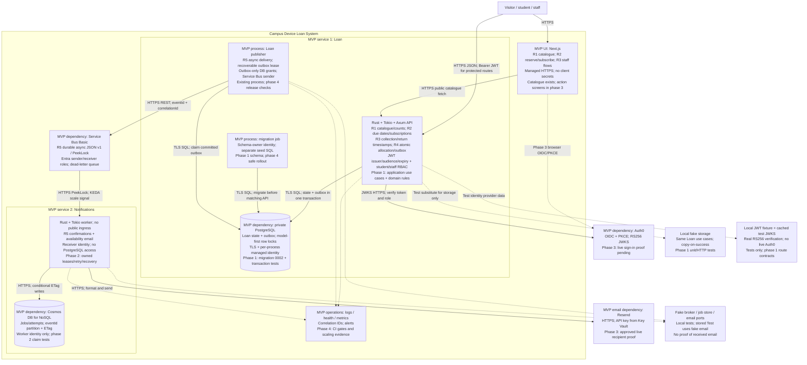

# Stage 2 annotated Container plan

Date: 2026-11-01. Design follows ADRs 0002–0004. Backend phase 1 is implemented and tested locally. Other phases remain planned. **Tutor feedback and approval status: unknown; no record was supplied. This assessment note does not block backend work.** MVP labels below are the proposed scope for tutor review.

This new diagram copies the current Container structure and adds requirement, security, fake and build-order labels. The two business services are Loan and Notifications; the publisher belongs to Loan.

| Label | Requirement and evidence target |
| --- | --- |
| R1 | Public brand/model/category catalogue and unit counts. Existing name carries brand/model. |
| R2 | Signed-in reservation with automatic two-day due date and model subscription. Phase 1 API; browser flow phase 3. |
| R3 | Staff collection/return, role checks and timestamps. Local signed-JWT routes tested; live proof phase 3. |
| R4 | One winner for last unit; state/outbox rollback together. Real local PostgreSQL tests in phase 1. |
| R5 | Collection/return confirmations and all active subscribers on return. Stable v1 requests in phase 1; worker recovery phase 2; received email phase 3. |
| Operations | Stateless processes, bounded DB connections, durable queue, health/logs/metrics, IaC, Test CI and gated promotion. Existing source/stored evidence; phase 4 closes evidence gaps. |

Build order: (1) Loan rules, ports, migration and tests; (2) notification lease/retry/recovery; (3) Auth0 plus student/staff screens and email proof; (4) release order, seeding, CI/gates and scaling evidence. Screens and owned worker leases are locally implemented (phases 2–3). Phase 4 locally tests the release path; live acceptance and tutor approval remain open. See [phase 4 handoff](phase-4-handoff.md).

The brief asks for tutor approval of final MVP choices. The review can cover scope, the reservation-based 48-hour clock and fakes in the demo. Local implementation proceeds under the user's request; it does not grant tutor approval.

Current C4/deployment diagrams: [assessment evidence map](../cloud/assessment-evidence.md). API and event details: [contracts](contracts.md). No cross-service database access or synchronous Loan lookup by Notifications is allowed.
