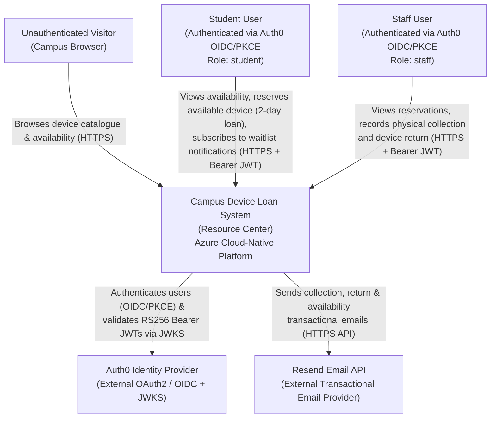
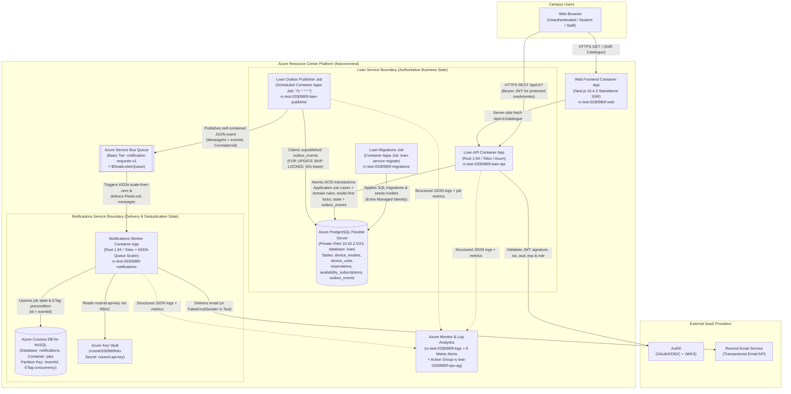
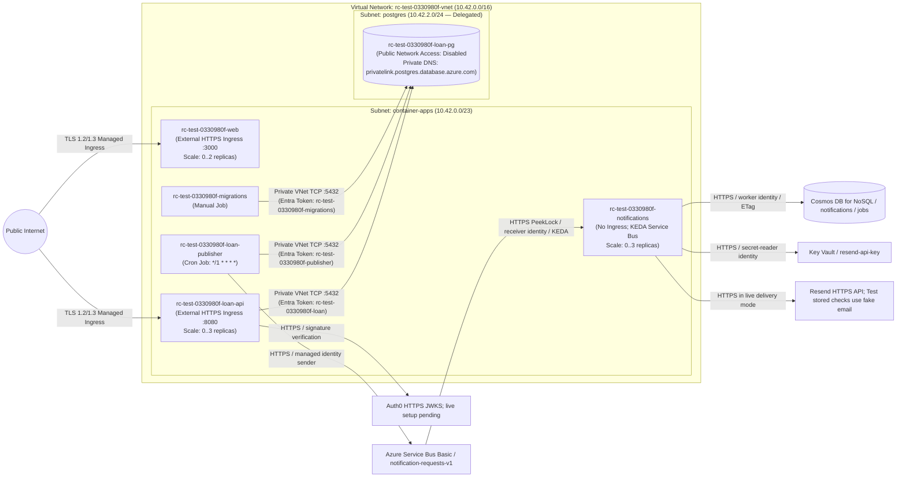

# Resource Center — CIS3039 Cloud-Native DevOps Assessment Evidence Map

- **Date**: 2026-11-01
- **Assessment Specification Source**: `/home/cabozzz/Downloads/cnd-cis3039-assessment-spec.docx` (verified directly against original specification; never inferred from memory)
- **Live Cloud Environment**: Azure Test (`francecentral`, subscription `0330980f-85ea-4b38-8b9e-c871432c9d4f`)
- **Architecture Baselines**:
  - Original Handoff: [`docs/architecture/2026-10-25-resource-center-handoff.md`](file:///home/cabozzz/dev/resource.center/docs/architecture/2026-10-25-resource-center-handoff.md)
  - ADR 0001 (Azure Foundation & Free-Tier Selection): [`docs/architecture/adr/0001-azure-foundation.md`](file:///home/cabozzz/dev/resource.center/docs/architecture/adr/0001-azure-foundation.md)
  - ADR 0002 (Rust + Tokio + Axum Backend): [`docs/architecture/adr/0002-rust-backend.md`](file:///home/cabozzz/dev/resource.center/docs/architecture/adr/0002-rust-backend.md)
  - ADR 0004 (Loan rules and recovery): [backend design](../architecture/adr/0004-backend-use-cases-and-recovery.md)
  - ADR 0003 (Phase 2 Workloads & Managed Container Apps HTTPS Ingress): [`docs/architecture/adr/0003-phase2-workloads-and-ingress.md`](file:///home/cabozzz/dev/resource.center/docs/architecture/adr/0003-phase2-workloads-and-ingress.md)

---

## 1. Stage 1 — Architecture & C4 Diagrams

Topology reflects the selected design. Backend phase 1 is verified locally, not deployed by this change. Browser sign-in/actions remain phase 3 work. Stored Test results below are not a fresh live check.

### 1.1 C4 Level 1 — System Context Diagram

### 1.2 C4 Level 2 — Container Diagram

### 1.3 Cloud Deployment & Network Isolation Diagram

---

## 2. Stage 2 — Component Mapping, Security, Fakes, MVP & Build Priority

The [new Stage 2 annotated Container diagram](../backend/stage-2-plan.md) maps requirements, security, fakes, MVP scope and phase order. Tutor feedback/approval status is unknown. This table records supporting context.

| Priority Order | Container / Component | Functional & Non-Functional Requirements Mapped | Auth & Security Controls | Faked / Simulated Connections in Test | In MVP? |
| --- | --- | --- | --- | --- | --- |
| **1 (MVP Core)** | **PostgreSQL (`rc-test-0330980f-loan-pg`) + Migrations Job (`loan-service migrate`)** | Authoritative schema (`device_models`, `device_units`, `reservations`, `availability_subscriptions`, `outbox_events`), 2-day loan rule, transactional outbox durability, least-privilege publisher grants. | Private VNet subnet (`10.42.2.0/24`), public access disabled, Microsoft Entra Managed Identity tokens, `publisher` restricted to `outbox_events` (`SELECT`/`UPDATE`) and `notifications` identity denied (`28P01`). | None (real Azure PostgreSQL Flexible Server in Test). | **Yes (MVP DB 1)** |
| **2 (MVP Core)** | **Loan API (`rc-test-0330980f-loan-api`, `loan-service api`)** | Public device catalogue (`GET /api/v1/catalogue`), authenticated student reservation (`POST /api/v1/reservations`) with model-first row-lock concurrency control, waitlist subscription (`POST /api/v1/subscriptions`), staff collection (`POST /api/v1/reservations/{id}/collect`) & return (`POST /api/v1/reservations/{id}/return`), `/health/live` and `/health/ready`. | Managed TLS ingress, strict CORS allowlist (`ALLOWED_ORIGIN`), Auth0 RS256 JWKS validation (`Auth0JwtVerifier`), RBAC role enforcement (`student` vs `staff`), fails closed (`503 AuthNotConfigured`) when Auth0 env vars are blank. | In unit/integration tests: transactional fake storage and locally signed JWTs with cached test JWKS. In live Test: Auth0 is unconfigured (`auth0Configured: false`), so write routes fail closed (`503`) while live DB concurrency/RBAC are verified via `verify-resilience`. | **Yes (MVP Service 1)** |
| **3 (MVP Core)** | **Outbox Publisher Job (`rc-test-0330980f-loan-publisher`, `loan-service publish`) + Service Bus (`notification-requests-v1`)** | Asynchronous decoupling between Loan commits and Notifications; claims unpublished `outbox_events` rows with 60s lease (`claimed_until`), publishes self-contained event envelopes (`DeviceCollectionConfirmationRequested`, `DeviceReturnConfirmationRequested`, `DeviceAvailabilityNotificationRequested`) to Service Bus with `MessageId = eventId` and `CorrelationId`. | Passwordless Entra Managed Identity (`rc-test-0330980f-publisher`) with `Azure Service Bus Data Sender` role on `notification-requests-v1` only. | In unit tests: fake broker port. In live Test: real scheduled Container Apps Job + real Azure Service Bus Basic queue. | **Yes (MVP Async Bridge)** |
| **4 (MVP Core)** | **Notifications Worker (`rc-test-0330980f-notifications`) + Cosmos DB (`notifications`/`jobs`)** | KEDA scale-from-zero queue consumer; idempotency and delivery state tracking in Cosmos DB (`id = eventId`, `/eventId` partition key, `_etag` optimistic concurrency); retry classification (transient retry vs permanent dead-letter). | Passwordless Entra Managed Identity (`rc-test-0330980f-notifications`) with `Azure Service Bus Data Receiver`, Cosmos Built-in Data Contributor (`00000000-0000-0000-0000-000000000002`), and Key Vault Secrets User. Zero access to PostgreSQL. | **`FakeEmailSender` (`EMAIL_DELIVERY_MODE=fake`)**: Used in Test so zero real emails are dispatched while full Cosmos DB state transitions (`Claimed` → `Delivered`) and Service Bus settlement are exercised. (`ConfigurableEmailSender` supports Resend mode with a Key Vault secret). | **Yes (MVP Service 2 + MVP DB 2)** |
| **5 (Portal UI)** | **Web Frontend (`rc-test-0330980f-web`, Next.js 16.4.3)** | Responsive campus portal displaying real-time device models, categories, 2-day loan duration, available/total unit counts, architecture boundary status, and `/api/health` readiness endpoint. | Managed TLS ingress, non-root Node 22 Alpine container, server-side fetch to `LOAN_API_BASE_URL`. | Browser login and action flows are not implemented; status badges only show configuration. Credentials alone will not add those flows. | **Yes (Frontend Container)** |

---

## 3. Requirement evidence and limits

Source review: 2026-11-01. The rows below distinguish current code from stored runtime evidence. No live recheck ran during this review. Full findings: [cloud backend alignment](../assessment/2026-11-01-cloud-backend-alignment.md).

| Requirement | Status | Evidence and remaining work |
| --- | --- | --- |
| Public catalogue and counts | Implemented; stored Test evidence | API and Next.js catalogue exist. Confirm brand/model/category are clear in demo. Signed-in browser flows remain absent. |
| Reservation with return date | Implemented and verified locally; not deployed | Phase 1 assigns dueAt at reservation and preserves it on collection. Migration 0002 preserves valid old dates and backfills null dates. See [handoff](../backend/phase-1-handoff.md). |
| Concurrent reservation | Code plus stored PostgreSQL check | Model-first locks; phase 1 local PostgreSQL five-way race has one winner. Partial-write rollback, concurrent returns and multi-subscriber outbox checks also pass. HTTP tests use fake storage with real local JWT verification. |
| Availability subscription | Backend implemented | Route and SQL subscription exist. Browser action and live authenticated proof remain open. |
| Collection/return/availability messages | Backend plus stored fake-delivery checks | Return selects active subscribers for the model; collection/return state and outbox writes are atomic. Stored three-event flow reaches Cosmos with fake email, not real recipient delivery. |
| Auth0/JWT/RBAC | API code; incomplete user flow | JWT validator and role checks exist. Recorded Test configuration returns AuthNotConfigured on protected routes. Browser login/actions and live valid/invalid-token/403 evidence remain open. |
| Resilience/idempotency | Partial evidence | Stored publisher lease recovery and tests for terminal duplicate/retry handling. Concurrent nonterminal worker claims, send/crash windows and full outage/backlog recovery still need proof. |
| Observability | Code and stored Test checks | JSON logs, correlation, probes, publisher metrics, KQL and six alerts exist. Synthetic alert-routing test was blocked by Azure Students policy; actual delivery not verified. |
| CI/CD and promotion | Workflow files implemented; execution proof incomplete | YAML defines Test automation and manual promotion confirmation. Need successful GitHub runs and verified environment gate settings. Test rollout precedes migrations; promotion lacks migration wait/smoke checks. |
| IaC/scaling | Code and stored Test evidence | Terraform roots and remote state exist; worker scale-from-zero recorded. Forty successful catalogue requests are limited load evidence, not proof of HTTP scale-out. Staging/Production only parameterized. |

## 4. Remaining work

- Obtain tutor approval for the prepared Stage 2 diagram, MVP/fakes/build order and due-date rule.
- Deploy the tested due-date migration/API through a safe release; implement browser sign-in/student/staff actions.
- Configure and verify Auth0 and email where required by approved scope; do not label fake outputs as live results.
- Complete concurrent duplicate/failure recovery tests and capture real GitHub pipeline/gate evidence.
- Make release order and promotion checks safe; reconcile disabled Staging/Production seed settings with per-deployment demo-data requirement.
- Produce the 1,500–2,000-word report, screenshots and clips, then the required Media/Source/Documentation ZIP and root readme.
